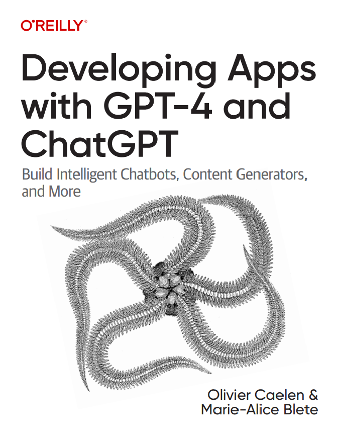

This repository contains different examples and use cases showcased in the book <a href="https://appswithgpt.com">Developing Apps with GPT-4 and ChatGPT</a>.

If you are coming from the first edition, you will find that the code has been updated to use a more recent OpenAI Python library version. You will also find additional code examples that are not in this book's first edition. To switch back to the original code, go to <a href="https://github.com/malywut/gpt_examples/releases/tag/0.27">this tag</a>. The chapters and numbering of the examples are identical across book editions.

# Usage

### All examples
Install the requirements for all the examples with:

    pip install -r requirements.txt

Each example contains either a Jupyter notebook, or a Python file that can be run with:

    python [example_folder]/run.py

Some examples require some additional setup.

### Chap3_03_QuestionAnseringOnPDF
Start Redis with

    docker-compose up -d

### Chap3_04_VoiceAssistant
The Gradio interface is available at the address displayed in the output.

### Chap5_04_LlamaIndexCustomization
Customize if needed the docker-compose.yml file and start Weaviate with

    docker-compose up -d
Alternatively, run:

    docker run -p 8080:8080 -p 50051:50051 cr.weaviate.io/semitechnologies/weaviate:1.39.13

If you started an older Weaviate version with docker-compose before, remove its volume first with `docker-compose down -v` (running `run.py` indexes the files again).
